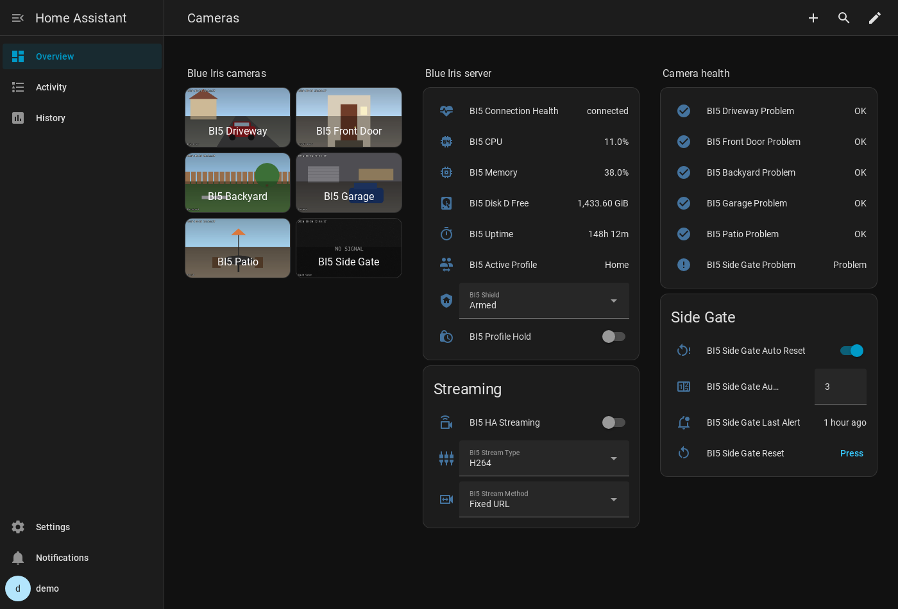
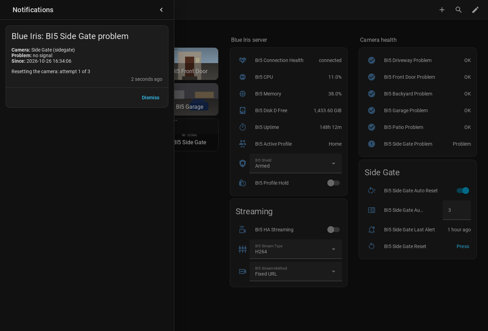
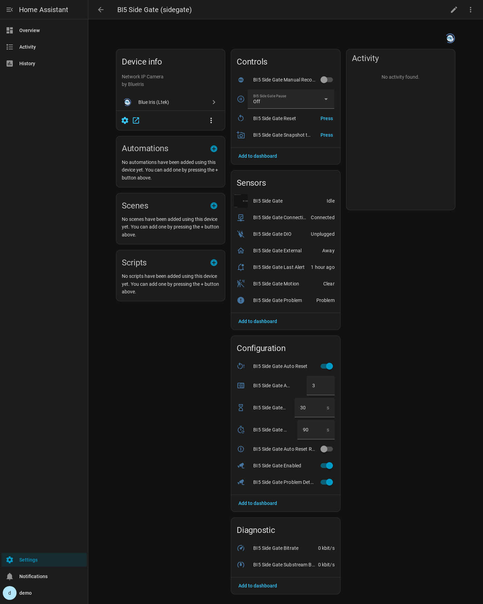
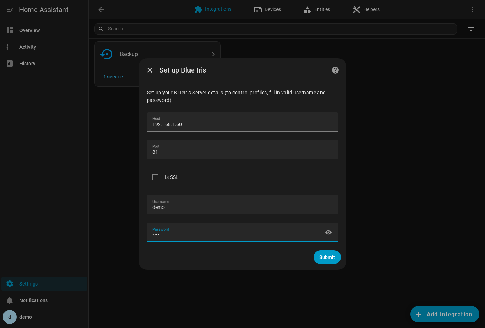
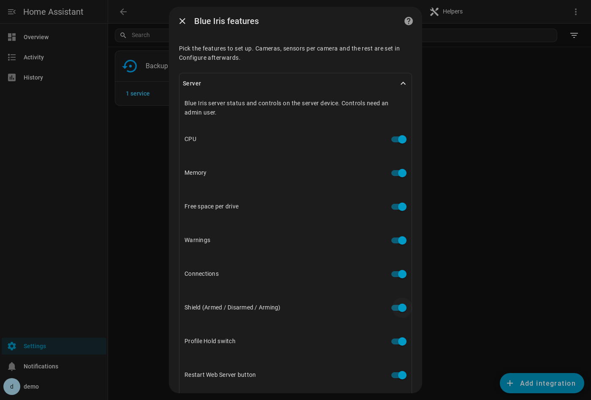
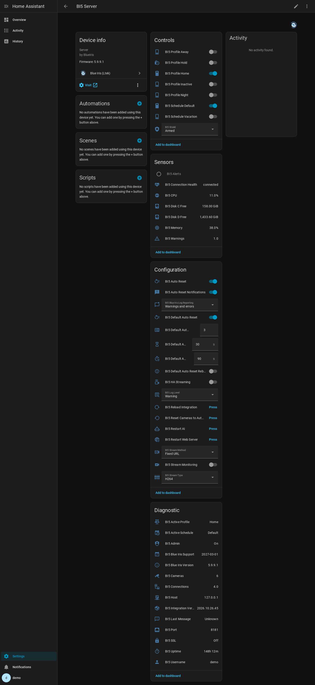
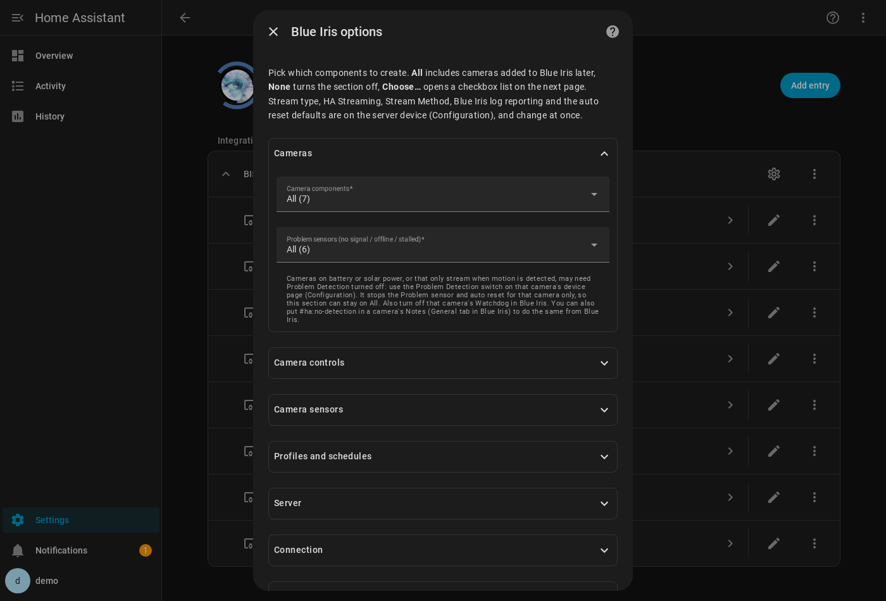

# Blue Iris (Ltek)

Blue Iris (Ltek) is a fork of the no-longer maintained [elad-bar/ha-blueiris](https://github.com/elad-bar/ha-blueiris). It keeps the same `blueiris` domain and **is a direct in-replace upgrade**: your config entry and existing entities stay as they are and you get a ton more features and controls (if you choose to).

Current build: **v2026.10.26.45** · full history in [CHANGELOG.md](CHANGELOG.md)

[](https://my.home-assistant.io/redirect/hacs_repository/?owner=Ltek&repository=ha-blueiris&category=integration)



## Why I forked it...

Several of my 15 cameras kept dropping to "No signal", often would not reconnect until I forced a reload/reset in Blue Iris. I wanted to fix these streams and also have the integration automatically detect problems and fix it. It grew from there.

## NEW in this fork...

**Camera health and auto reset**
- **Problem sensor per camera:** on for *no signal*, *offline* or a *stalled* stream (below 1 FPS), based on Blue Iris' own camera status. It goes unavailable while the server is down or has just started, so automations never act on stale data.
- **Auto reset:** resets a camera when its Problem sensor stays on. Delay, number of attempts and interval can be set per camera and changed live. It can also reboot the camera after the last reset. You get one persistent notification per camera (problem, since when, outcome) and a `blueiris_auto_reset` event you can use for phone alerts.
- **Problem Detection switch per camera** for battery, solar or motion-only cameras. You can also put `#ha:no-detection` in the camera's Notes in Blue Iris.
- **Reset button** per camera, and a `blueiris.reset_camera` service.



**Camera controls and sensors**
- **Controls:** Enabled, Pause (30 s to 24 h, or indefinitely), Manual Recording, Snapshot to Database. Motion Detection and Reboot are optional.
- **Sensors:** bitrate (main and sub stream) and last alert. Recording, Triggered and Alerting are optional.
- Each camera's device page links to the camera's own web interface.

**Server**
- **Status:** Connection Health, Uptime, CPU, Memory, free space per drive, warnings and connections. Read-only info: host, port, SSL, user, admin rights, versions, active profile and schedule.
- **Controls:** Shield (Armed / Disarmed / Arming), Profile Hold, Restart Web Server, Restart AI, Reload Integration.
- **Blue Iris log:** new warnings and errors arrive as `blueiris_log` events.
- **Settings on the server device:** stream type, HA streaming, stream method, log level, and the auto reset defaults all live on the server device. You can see them and change them without reloading.



**Streaming**
- **Stream types**: H264 (HLS), H264 TS, MJPEG, plus **RTSP** and **RTSP sub stream** from Blue Iris' web server port. RTSP skips Blue Iris' HLS step, which on my system was returning `5XX` errors to Home Assistant. RTSP was the smoothest and most reliable for me. fixed all my disconnect problems.
- **HA Streaming switch:** turns Home Assistant's own stream (HLS / WebRTC) on or off for all cameras, without a restart.
- **Stream Monitoring**: `blueiris_stream` events and a per-method Stream Health sensor, to help track down stream problems.

**Setup**
- Easier now: All / None / Choose… per section, with item counts and checkbox lists. Cameras added to Blue Iris later are picked up automatically under *All*.
- Diagnostics download, with credentials, session and location redacted.

Everything from the original is still there: camera entities, the MQTT binary sensors (Motion, Audio, Connectivity, DIO, External), profile and schedule switches, Trigger Camera and Move to Preset.

## Installation

The integration isn't in the default HACS list, so you add it as a custom repository. The button does that in one click:

[](https://my.home-assistant.io/redirect/hacs_repository/?owner=Ltek&repository=ha-blueiris&category=integration)

**MIGRATING from elad-bar's version?** In HACS, remove elad-bar's *repository* first. Don't delete the integration under Settings → Devices & Services. Then add this one. The config entry and entities carry over.

**Requirements:**
- A Blue Iris user account. Many features need **admin** rights: controls, auto reset, the Blue Iris log, profiles and schedules.
- MQTT is optional. You only need it for Blue Iris' motion, audio, DIO and external events.

Setup and all the options are documented in [SETUP.md](SETUP.md). The README describes every entity.

## Good to know

- **Many cameras on a dashboard:** some older browsers have a limit of 6 connections per server over plain HTTP, hit by MJPEG views. Turning on **HA Streaming** on the server device, together with `live_provider: ha` in Advanced Camera Card, avoids it. So does accessing HA over HTTPS / HTTP/2.
- **Ring and other bridged cameras:** if they keep dropping with Blue Iris' *"Check FPS and key rates"* warning, try turning off **Limit decoding** for them in Blue Iris. That fixed it for my Ring doorbell.
- **Frozen frames:** a camera that keeps sending the same frame at a normal frame rate can't be detected. Blue Iris still reports it as healthy.
- I've tested everything against my own Blue Iris 5 setup, and with automated tests against a simulated Blue Iris server. Other Blue Iris versions may return some fields differently. If a sensor shows `unknown`, please open an issue with the diagnostics download attached.

## Components

###### Binary Sensor - Alerts

Represents whether there is an active alert or not

| Attributes         |
| ------------------ |
| Active alerts #    |
| System name        |
| Version            |
| License            |
| Support expiration |
| Logged in User     |
| Latitude           |
| Longitude          |

###### Binary Sensor - Connectivity - Non-system-camera

Represents whether the camera is online or not (based on MQTT message)

###### Binary Sensor - Audio - Non-system-camera and camera supports audio

Represents whether the camera is triggered for noise or not (based on MQTT message)

###### Binary Sensor - Motion - Non-system-camera

Represents whether the camera is triggered for motion or not (based on MQTT message)

###### Binary Sensor - DIO - Non-system-camera

Represents whether the camera is triggered for digital I/O event or not (based on MQTT message)

###### Binary Sensor - External - Non-system-camera

Represents whether the camera is triggered for external / ONVIF event or not (based on MQTT message)

###### Binary Sensor - Problem - Per camera (not groups or system cameras)

On when the camera needs attention, computed from Blue Iris' camera list on every poll (not MQTT):

| Reason      | Condition                                       |
| ----------- | ----------------------------------------------- |
| `no_signal` | Blue Iris reports No Signal                     |
| `offline`   | Camera is not online                            |
| `stalled`   | Online but below 1 FPS                          |

Disabled and paused cameras never count as a problem. The sensor is **unavailable** while the server is not `connected` (see Connection Health) and for the first 5 minutes after Blue Iris starts, so it never reports stale or settling data. It also adds the camera to the server's Alerts sensor while on.

| Attributes      |
| --------------- |
| camera_id       |
| problem_detection |
| reason          |
| since           |
| fps             |
| is_online       |
| no_signal       |
| no_signal_count |
| error           |

A camera that keeps sending the same frame at a normal frame rate cannot be detected.

**Problem Detection switch** (`switch.<camera>_problem_detection`, Configuration section of the camera's device, on by default). Turn it off for cameras on battery or solar power, or that only stream when motion is detected: they look "down" most of the time by design, and reconnect attempts can wake them and drain the battery. While it is off, the camera's Problem sensor stays `off` with `problem_detection: false`, it is left out of the Alerts sensor, and auto reset never touches it. Takes effect at once, is kept across restarts and is not changed by *Set all cameras back to these defaults*. Also turn off that camera's Watchdog in Blue Iris.

The same can be set from Blue Iris: put `#ha:no-detection` anywhere in the camera's **Notes** (camera settings, General tab). It overrides the switch, which then shows off with a `set_by` attribute and can't be turned on until the tag is removed. Takes effect on the next poll.

###### Button - Reset - Per camera (admin user)

Resets (reconnects) the camera, the same as the Reset Camera service. Created for cameras that have a camera entity.

###### Auto reset (admin user)

Resets a camera automatically when its Problem sensor stays on.

**Defaults** are set on the server device (`switch.<server>_default_auto_reset`, `..._default_auto_reset_reboot`, `number.<server>_default_auto_reset_delay` / `_attempts` / `_interval`) and used by every camera you haven't changed on its own. Setup's *Blue Iris features* page sets their starting values:

| Default                | Built-in | Range       |
| ---------------------- | -------- | ----------- |
| Auto reset on          | On       | On / Off    |
| Delay before the first reset | 30 s | 30 - 3600 s |
| Attempts               | 3        | 1 - 10      |
| Interval between resets | 90 s    | 30 - 900 s  |
| Reboot the camera after the last reset | Off | On / Off |

The server's **Reset Cameras to Auto Reset Defaults** button clears every camera's own values.

**Per camera**, the entities on its device (Configuration section) override the defaults for that camera only, value by value. Changes apply from the next poll (within 30 s) without a reload, and are kept across restarts. A camera keeps following the defaults for any value you haven't changed on it.

Problems are seen on the 30 s poll, so the first reset comes 30 - 60 s after a camera fails with the 30 s delay.

| Entity                                | Default | Range         | Meaning                                    |
| ------------------------------------- | ------- | ------------- | ------------------------------------------ |
| `switch.<camera>_auto_reset`          | default | -             | Auto reset this camera                     |
| `number.<camera>_auto_reset_delay`    | default | 30 - 3600 s   | How long the problem must last first       |
| `number.<camera>_auto_reset_attempts` | default | 1 - 10        | Resets before giving up                    |
| `number.<camera>_auto_reset_interval` | default | 30 - 900 s    | Wait after each reset before the next one  |
| `switch.<camera>_auto_reset_reboot`   | default | -             | Reboot the camera itself once after the last reset, before giving up |

On the server device:

| Entity                               | Meaning                                                            |
| ------------------------------------ | ------------------------------------------------------------------ |
| `switch.<server>_auto_reset`         | Master switch; off pauses auto reset for every camera               |
| `switch.<server>_auto_reset_notifications` | Persistent notifications on / off                            |

How it works, on every successful poll:

1. Problem for at least *Delay* -> reset; then up to *Attempts* resets, *Interval* apart
2. Problem clears -> **recovered**
3. Still on *Interval* after the last attempt -> if *Reboot* is on, the camera is rebooted once (Blue Iris' reboot command, only for cameras that support it) and gets one more *Interval*; then **gave up**. No more resets until the problem clears and comes back

It pauses while Connection Health is not `connected` and for the first 5 minutes of Blue Iris uptime, so an outage or a Blue Iris restart never triggers resets. Progress is on the Problem sensor (`auto_reset_state`: off, paused, idle, waiting, resetting, gave_up; `auto_reset_attempts`; `auto_reset_last`). After a Home Assistant restart the count starts over.

Each camera gets one persistent notification (camera, problem, since, then the outcome), updated in place. Turn them off with the server's Auto Reset Notifications switch.

Every step also fires the event `blueiris_auto_reset` with `type` (`reset`, `reboot`, `recovered`, `gave_up`), `rebooted`, `camera_id`, `camera_name`, `entity_id` (the camera entity), `reason`, `since`, `attempt`, `max_attempts` and `error`. For a phone alert with a snapshot when a camera gives up:

```yaml
triggers:
  - trigger: event
    event_type: blueiris_auto_reset
    event_data:
      type: gave_up
actions:
  - action: blueiris.current_camera_snapshot
    target:
      entity_id: "{{ trigger.event.data.entity_id }}"
    response_variable: snap
    continue_on_error: true
  - action: notify.mobile_app_phone
    data:
      title: "Blue Iris: {{ trigger.event.data.camera_name }} still down"
      message: "{{ trigger.event.data.reason }} after {{ trigger.event.data.attempt }} resets"
```

Blue Iris has its own per-camera Watchdog (camera properties) for signal loss. If it is on, give it a shorter timeout than the auto reset delay, or turn one of them off for that camera.

###### Camera sensors

Per camera (not groups or system cameras), from Blue Iris' camera list on every poll. Choose which cameras get each sensor in Configure -> Camera sensors.

| Entity                                     | Default | Value                                                                     |
| ------------------------------------------ | ------- | ------------------------------------------------------------------------- |
| `sensor.<camera>_bitrate`                  | All     | Main stream, kbit/s (Blue Iris sends bytes/s); attributes fps, width, height (diagnostic) |
| `sensor.<camera>_substream_bitrate`        | All     | Same for the sub stream; only for cameras that have one (diagnostic)      |
| `sensor.<camera>_last_alert`               | All     | Time of the most recent alert; attributes new_alerts, alerts, triggers, clips, record |
| `binary_sensor.<camera>_recording`         | None    | Recording                                                                 |
| `binary_sensor.<camera>_triggered`         | None    | Triggered                                                                 |
| `binary_sensor.<camera>_alerting`          | None    | Sending an alert                                                          |

Recording, Triggered and Alerting come from the 30 s poll, so short events can be missed; the MQTT Motion sensors are better for motion.

###### Camera controls (admin user)

Per camera (not groups or system cameras), on its device page. Choose which cameras get each control in Configure -> Camera controls.

| Entity                                   | Default | What it does                                                              |
| ---------------------------------------- | ------- | ------------------------------------------------------------------------- |
| `switch.<camera>_enabled`                | All     | Enables / disables the camera in Blue Iris (Configuration)                |
| `select.<camera>_pause`                  | All     | Off, 30 s ... 24 h, Indefinitely; attributes `remaining` (s) and `until`. Shows unknown while a timed pause set elsewhere runs |
| `switch.<camera>_manual_recording`       | All     | Starts / stops manual recording                                           |
| `button.<camera>_snapshot_to_database`   | All     | Saves a snapshot into Blue Iris' clips database (its timeline / UI3), not a file in Home Assistant |
| `switch.<camera>_motion_detection`       | None    | Motion detection for the camera's active profile; read every 5 minutes (Configuration) |
| `button.<camera>_reboot`                 | None    | Reboots the camera itself; only for cameras that support it through Blue Iris (Configuration) |

Changes are sent to Blue Iris at once and read back straight away. Errors from Blue Iris show as an error on the action, with Blue Iris' reason.

###### Camera

State: Idle

| Attributes                                      |
| ----------------------------------------------- |
| FPS                                             |
| Audio support                                   |
| Width                                           |
| Height                                          |
| Is Online                                       |
| Is Recording                                    |
| Issue (Camera is yellow)                        |
| Alerts #                                        |
| Triggers #                                      |
| Clips #                                         |
| No Signal #                                     |
| Error                                           |
| Group Cameras (list of camera names if a group) |
| IP                                              |

The camera's device page has a **Visit** link to `http://<camera IP>` (the camera's own web interface), when Blue Iris reports an IP.

###### Sensor - Connection Health

Health of the connection to the Blue Iris server, refreshed on every poll. Useful to keep automations from acting on stale camera data while the server is down.

| State                | Meaning                                                   |
| -------------------- | --------------------------------------------------------- |
| `connecting`         | No poll has completed yet                                 |
| `connected`          | Last poll succeeded                                       |
| `server_unreachable` | Blue Iris did not respond                                 |
| `auth_failed`        | Blue Iris responded but the login was rejected            |
| `error`              | Logged in, but Blue Iris returned a failure for a request |

| Attributes           |
| -------------------- |
| last_update_success  |
| last_success_time    |
| consecutive_failures |
| is_logged_in         |
| bi_version           |
| profile              |
| schedule             |

###### Sensors - Server status

From Blue Iris' status on every poll, each can be turned off in Configure -> Server sensors:

| Sensor                      | Value                                                                  |
| --------------------------- | ---------------------------------------------------------------------- |
| `sensor.<server>_cpu`       | CPU use (%)                                                            |
| `sensor.<server>_memory`    | System memory in use (%); attributes Blue Iris RAM and installed RAM   |
| `sensor.<server>_disk_<drive>_free` | Free space per drive (GiB); attributes allocated, used, total, free %, and the raw values Blue Iris sent |
| `sensor.<server>_warnings`  | Warnings on Blue Iris' Messages page                                   |
| `sensor.<server>_connections` | Active web server connections (diagnostic)                           |

###### Server controls (admin user)

| Entity                          | What it does                                                                         |
| ------------------------------- | ------------------------------------------------------------------------------------ |
| `select.<server>_shield`        | Blue Iris' shield: Armed (green), Disarmed (red), Arming (yellow)                    |
| `switch.<server>_profile_hold`  | On holds the current profile; off lets the schedule run. Attribute `lock`: run, hold or temporary |
| `button.<server>_restart_web_server` | Restarts Blue Iris' web server (Configuration). The integration logs in again on the next poll |
| `button.<server>_restart_ai`    | Restarts Blue Iris' AI (Configuration)                                               |

Each can be turned off in Configure -> Server.

###### Blue Iris log (admin user)

New Blue Iris log messages are read on every poll. Each warning or error (or errors only, see the server's Blue Iris Log Reporting) fires the event `blueiris_log` with `level`, `object` (camera or part of Blue Iris), `message`, `time` and `count`, and updates `sensor.<server>_last_message` (diagnostic). Messages from before Home Assistant started are not reported. For example, to be told about Blue Iris errors:

```yaml
triggers:
  - trigger: event
    event_type: blueiris_log
    event_data:
      level: error
actions:
  - action: notify.mobile_app_phone
    data:
      title: "Blue Iris: {{ trigger.event.data.object }}"
      message: "{{ trigger.event.data.message }}"
```

###### Sensor - Uptime

Blue Iris software uptime (duration, shown in hours by default), diagnostic entity

###### Switch - Profile (Per profile)

Allows setting the active profile, only one of the profile switches can be turned on at a time.

If you turn off one of the switches it will behave as follows:

- Profile #1 is turned off, it will turn on Profile #0
- Any of the other profiles are turned off, it will turn on Profile #1

###### Services

Trigger Camera: Provides the ability to manually trigger a camera or camera group

Move to Preset: Provides the ability to move a camera to a specified preset

Reset Camera: Resets (reconnects) a single camera, the same as Blue Iris' Reset command. The stream drops for a few seconds. Requires the integration's Blue Iris user to be an admin; camera groups are rejected

Snapshot to Database: Saves a snapshot into Blue Iris' own clips database, same as the camera's Snapshot to Database button. Not for groups

Current Camera Snapshot: Saves the camera's current still image to `media/blueiris/` (file name optional, default `<camera id>_current.jpg`) and returns `saved_path` and `local_snapshot_url` (`/media/local/blueiris/...`) as the service response, e.g. for a notification image:

```yaml
- action: blueiris.current_camera_snapshot
  target:
    entity_id: camera.bi5_driveway
  response_variable: snap
- action: notify.mobile_app_phone
  data:
    message: Driveway camera
    data:
      image: "{{ snap['camera.bi5_driveway'].local_snapshot_url }}"
```

## Lovelace UI Configuration

[Example of UI layout](docs/configs/casting/configuration.yaml)

## Casting

Currently the Stream Component is a bit too ragged to use to cast Blue Iris video streams, which don't need proxying.

#### Lovelace UI for casting

```YAML
# Example ui-lovelace.yaml view entry
  - type: entities
    title: Cast Camera to Screen
    show_header_toggle: false
    entities:
      - entity: input_select.camera_dropdown
      - entity: input_select.cast_to_screen_dropdown
      - entity: script.execute_cast_dropdown
```

[Example of configuration output](docs/configs/casting/ui-lovelace.yaml)

## Credit

Thanks to **elad-bar**, **kramttocs** and the other contributors. This fork is on elad-bar's code base.

Upstream contributors: <a href="https://github.com/darkgrue">@darkgrue</a>

## Screenshots

These are taken from a real Home Assistant running this integration against a made-up Blue Iris server (`tools/screenshots/fake_blue_iris.py`; no real cameras or data). To make them again: `PYTHON=<venv with homeassistant, home-assistant-frontend, pillow> tools/screenshots/run.sh` (needs Node with `playwright-core` and its Chromium). Push the PNGs in `screenshots/`; the *Update Screenshot Grid* workflow rebuilds the gallery.

<!-- SCREENSHOTS:START -->
<table>
  <tr>
    <td align="center" valign="top" width="50%">
      <a href="screenshots/01-setup-server-details.png"></a><br><sub>Setup server details</sub>
    </td>
    <td align="center" valign="top" width="50%">
      <a href="screenshots/02-setup-features.png"></a><br><sub>Setup features</sub>
    </td>
  </tr>
  <tr>
    <td align="center" valign="top" width="50%">
      <a href="screenshots/03-dashboard.png"></a><br><sub>Dashboard</sub>
    </td>
    <td align="center" valign="top" width="50%">
      <a href="screenshots/04-server-device.png"></a><br><sub>Server device</sub>
    </td>
  </tr>
  <tr>
    <td align="center" valign="top" width="50%">
      <a href="screenshots/05-camera-device.png"></a><br><sub>Camera device</sub>
    </td>
    <td align="center" valign="top" width="50%">
      <a href="screenshots/06-auto-reset-notification.png"></a><br><sub>Auto reset notification</sub>
    </td>
  </tr>
  <tr>
    <td align="center" valign="top" width="50%">
      <a href="screenshots/07-options.png"></a><br><sub>Options</sub>
    </td>
    <td></td>
  </tr>
</table>
<!-- SCREENSHOTS:END -->
